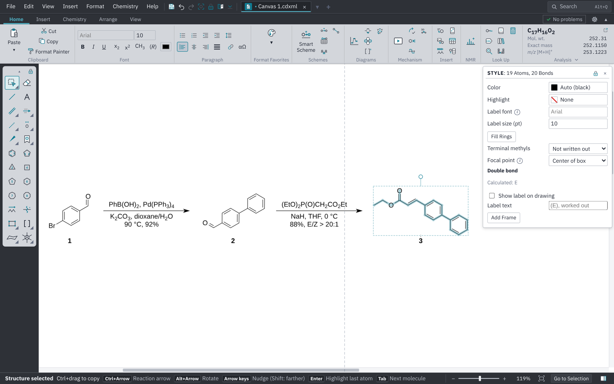
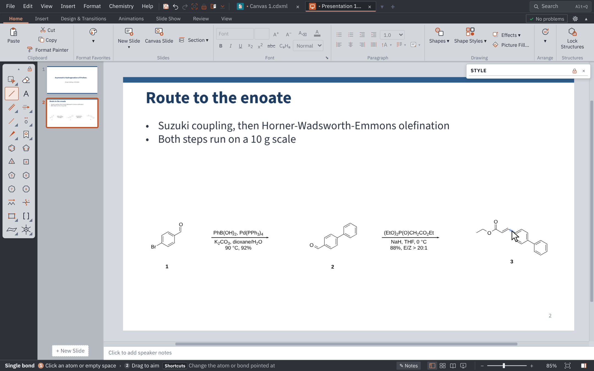
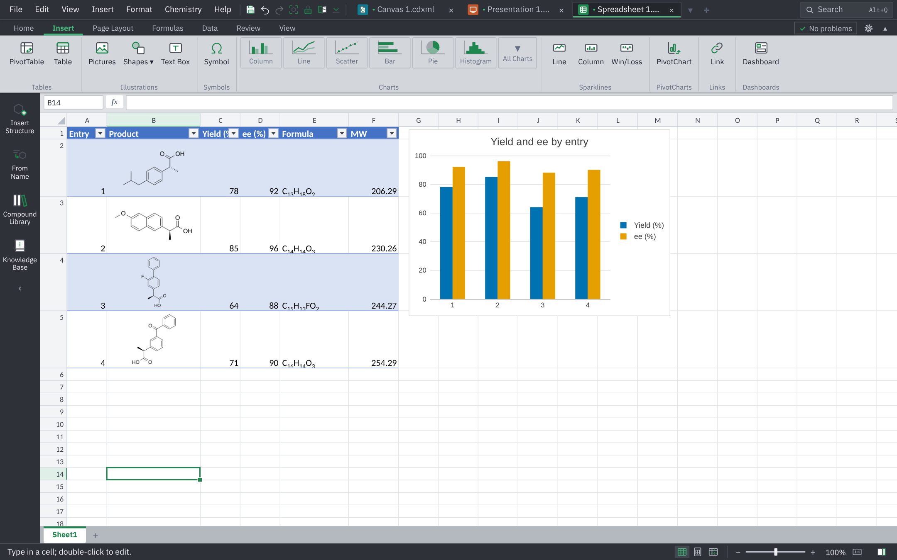
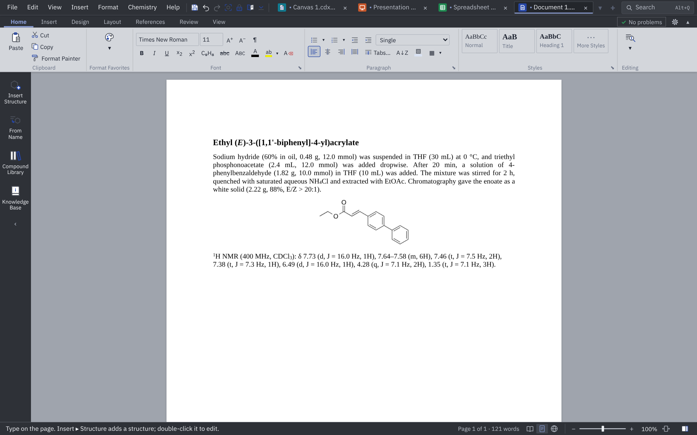
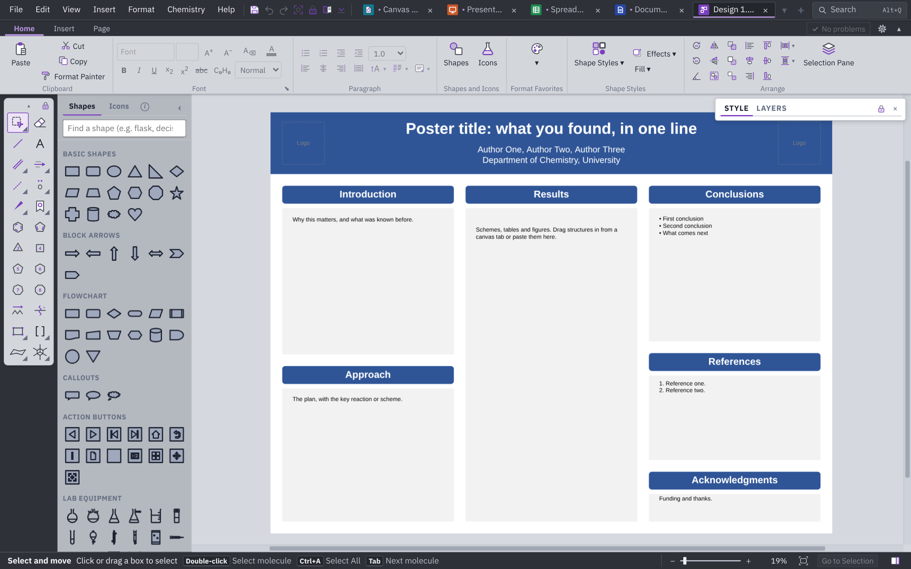
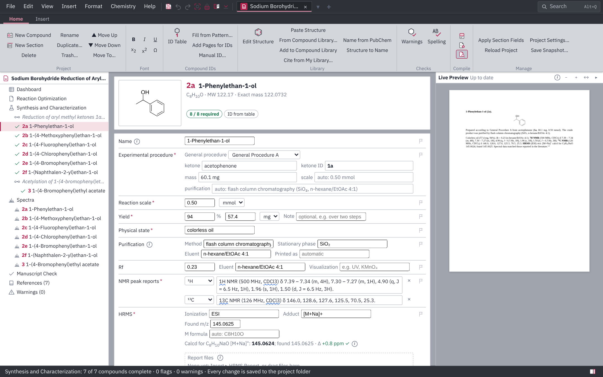

# Chemweave user guide

Chemweave is a free program for drawing chemical structures and putting them to work: in reaction schemes, presentations, spreadsheets, documents and graphics. These pages explain how to use it. They are written for chemists, not programmers.

## Start here

- **[Getting started](guide/getting-started.md)**: install the program (Windows, macOS, Linux), find your way around the window, open your ChemDraw files, save.
- **[Keyboard and mouse](guide/keyboard-and-mouse.md)**: the keyboard shortcuts of the Canvas and of the other modes, how to change them, what Shift, Ctrl and Alt do while you drag, and what each mouse pointer means.

## The modes

| | Mode | What it is for | Saves as |
|---|---|---|---|
|  | **[Canvas](guide/drawing.md)** (Chemistry) | Structures and reaction schemes, drawn with ChemDraw's tools and keyboard shortcuts, with formula, masses and stereo worked out as you draw | `.cdxml` (ChemDraw) |
|  | **[Presentation](guide/slides.md)** (Slideshow) | Talks and group meetings: layouts, templates, transitions, animations, presenter view | `.pptx` (PowerPoint) |
|  | **[Spreadsheet](guide/sheets.md)** (Tables, Charts, and Dashboards) | Tables of compounds: structures in cells, formula and mass columns, charts, isotope patterns, dashboards | `.xlsx` (Excel) |
|  | **[Document](guide/documents.md)** (Text document) | Reports, theses and experimentals: styles, structures in the text, captions, references, tracked changes, equations | `.docx` (Word) |
|  | **[Design](guide/design.md)** (Posters, Graphical abstracts, Figures) | TOC graphics, graphical abstracts, posters and flowcharts, with a shape library that includes lab glassware, and about 7,000 icons with lab and hazard signs | `.pptx` (one page) |
|  | **[SI Project](guide/si-project.md)** (Supporting Information) | The Supporting Information of a paper: compounds with their procedures, NMR, HRMS and spectra, checked as you enter them and compiled as a document or PDF. Desktop app only | a project folder (shared with Chem SI Assistant) |

Structures stay editable in every kind of file: double-click one on a slide, in a cell or in a document to change it with the drawing tools.

## Everything else

- **[Your libraries and Find Structure in Files](guide/libraries.md)**: the reference library (collections, tags, PDFs, PubMed, Zotero sync) and the compound library shared by every file, kept on this computer or in a shared folder, and searching a folder of files for a structure.
- **[Files and sharing](guide/files-and-sharing.md)**: every file type it opens and saves, copying to and from ChemDraw, Word and PowerPoint, Split View, workspaces, AutoSave, recovery after a crash, Version History, shared folders, printing and fonts.
- **[Troubleshooting](guide/troubleshooting.md)**: the program won't install or start, a damaged settings file, work that seems lost, where settings and recovery copies are kept.
- **[Feedback, problems and ideas](guide/feedback.md)**: how to send a feature request or report a problem from inside the program (**Help ▸ Send Feedback…**).
- **[For developers](developers.md)**: running it from the source code, how releases are made, and where things are in the code.
