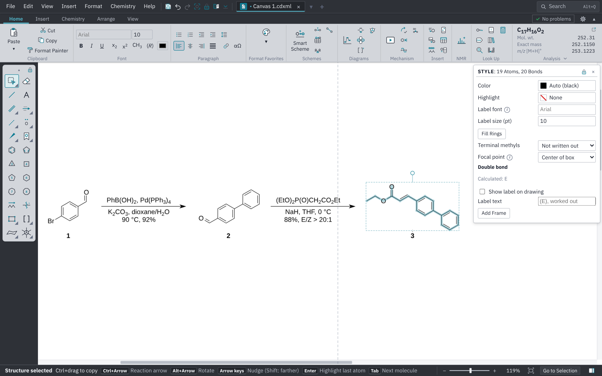

# Getting started

This page covers installing Chemweave, finding your way around the window, opening your first ChemDraw file, saving, and the Settings window.

Chemweave is free. It draws structures the way ChemDraw does (the same keyboard shortcuts, the same ACS Document 1996 look) and opens and saves ChemDraw's `.cdxml` and `.cdx` files. Besides the chemistry **Canvas**, it has four more modes, each in its own tab: **Presentation** (Slideshow), **Spreadsheet** (Tables, Charts, and Dashboards), **Document** (Text document) and **Design** (Posters, Graphical abstracts, Figures). The desktop app also has **[SI Project](si-project.md)** tabs for putting together a paper's Supporting Information.

A note on keys: this guide writes Ctrl, as on Windows and Linux. On a Mac, use Cmd wherever it says Ctrl, and Option wherever it says Alt.

## Installing

Download the newest installer from the **Releases** page of the project on GitHub: <https://github.com/nathanohare/Chemweave/releases>. The newest release is at the top. Open its **Assets** list and pick the file for your computer.

### Windows

1. Download the file ending in `x64-setup.exe` and run it.
2. Your browser or Windows may warn you first. Chemweave's installers are signed, but Microsoft also warns about any file that not many people have downloaded yet, and each new release starts out that way.
   - **Microsoft Edge** may say the file **"isn't commonly downloaded"**. In the Downloads list, point at the file, click **…** (More actions) and choose **Keep**; then **Show more** and **Keep anyway**.
   - Windows may say **"Windows protected your PC"** when the installer starts. Click **More info**, check that the publisher shown is the Chemweave developer's name rather than "Unknown publisher", then click **Run anyway**.
3. Follow the installer. A newer installer can be run over an older version; you don't need to remove the old one first.

The installer puts the app in your own user folder, so it doesn't need administrator rights. On a computer managed by an IT department, their rules may still block programs they haven't approved; if so, ask them, since neither the installer nor the portable copy below gets around those rules.

### Windows, without installing (portable copy)

A portable copy runs from a flash drive or any folder, with nothing installed, and keeps its settings with it.

1. Download the file ending in `x64-portable.zip`.
2. Right-click it, choose **Extract All…**, and put the **Chemweave** folder wherever you want it: a flash drive, Documents, the desktop.
3. Open the folder and double-click **Chemweave.exe**. The first time, Windows may warn as described above.

The **Chemweave Data** folder next to the app is what makes it portable: your keyboard shortcuts, preferences, styles, templates and recent files are saved there instead of on the computer, so the copy behaves the same on every computer you plug it into. Keep the two together, and copy both to move your copy. **Help ▸ Keyboard Shortcuts and Tips** shows "(portable)" after the version number.

Updates work as in an installed copy, except that **Install and Restart** replaces Chemweave.exe in its folder rather than installing anything. If the drive can't be written to (locked, or read-only), the app says so and keeps its settings on the computer for that session.

The app needs the Microsoft Edge WebView2 Runtime, which Windows 10 and 11 already have. The only thing a portable copy leaves on the computer is WebView2's cache in `%LOCALAPPDATA%\io.github.nathanohare.chemillustrator`, which holds none of your work or settings.

On macOS and Linux, a folder named **Chemweave Data** next to the app (or the AppImage) has the same effect.

### macOS

Works on Apple silicon and Intel Macs, macOS 12.3 or newer. On macOS 12, Structure to Name and reading structures or text from pictures don't work: that system lacks what they need.

1. Download the file ending in `universal.dmg`, open it, and drag **Chemweave** into **Applications**.
2. Open it from **Applications**. The app is signed with an Apple Developer ID and notarized by Apple, so macOS opens it immediately, with no warning.

### iPad

The iPad app is in testing through Apple's TestFlight.

1. Install the free **TestFlight** app from the App Store.
2. On the iPad, open the invitation link, [testflight.apple.com/join/hMdcFJBH](https://testflight.apple.com/join/hMdcFJBH), and tap **Accept**, then **Install**.
3. Open **Chemweave** from the Home Screen. TestFlight offers each new test version as it comes out, and test versions stop working after 90 days unless you update.

Draw with an Apple Pencil or your finger: see [Pen and touch](keyboard-and-mouse.md#pen-and-touch-tablets).

### Linux

Three file types are offered:

- **`.AppImage`**: runs on most distributions. Make it executable (in your file manager's Properties, or `chmod +x` on the file), then double-click it. The AppImage keeps itself up to date.
- **`.deb`** (Ubuntu, Debian) and **`.rpm`** (Fedora): install them like any other package. To update, download and install the newer one.

### Updates

<!-- index: Stable and Latest updates -->

A few seconds after it starts, the desktop app checks whether a newer version has been released. If there is one, a small message says which version is ready and what changed, and offers:

- **Install and Restart**: downloads it, installs it and restarts the app. Every tab you had open comes back as it was: the same tabs in the same order, the one showing, Split Screen, zoom and the slide you were on, and SI projects. Tabs with unsaved changes (and new ones never saved) come back unsaved, with their changes, so nothing needs saving first; your files on disk are not changed.
- **Later**: closes the message for now.
- **Skip This Version**: stops asking about this one version.

Each update is checked against the project's signing key before it installs, so only genuine releases are accepted. You can look for an update at any time with **File ▸ Check for Updates…**, and turn the automatic check off in **Edit ▸ Settings ▸ Online**.

**Edit ▸ Settings ▸ Online ▸ Updates** chooses which versions you are offered:

- **Latest** (the default): every new version, the day it is built. You get new features and fixes first.
- **Stable**: only versions that have been tried out on a real computer and found to work. They come less often and have fewer surprises, which suits people who mainly want to draw.

Switching from Latest to Stable never installs an older version: you keep the one you have until a newer stable version comes out.

### Beta

Chemweave is in **beta**: it is still being built, new features arrive often, and some things may not work as they should yet. The **Beta** mark beside Chemweave's name in the menu bar says so; click it for more. Save your work often, and please tell us about anything that goes wrong with **Help ▸ Report a Problem**.

## A tour of the window

### The menu bar

Along the top are the menus: **File**, **Edit**, **View**, **Insert**, **Format**, **Chemistry** and **Help**. Each menu shows the commands for the tab type you are in; a command for another kind of tab is left out (Insert ▸ Chart shows in a spreadsheet, not in a canvas). Under the menu bar every kind of tab has a ribbon of buttons, like Word, Excel and PowerPoint (see [The ribbon](#the-ribbon)).

In the web version the menus are in the **File** tab at the start of the ribbon, as in Office, and there is no menu bar: the quick bar, the open files' tabs and Search sit in the ribbon's own row of tabs, so the ribbon starts at the top of the window. **File** opens a page over the window with the menus down the left; pick one to see all its commands, its submenus each under their name. **Alt** and a menu's underlined letter open its page (**Alt+F** File, **Alt+E** Edit…), the arrow keys move through it, and **Esc** or the ← button goes back to your work. **View ▸ Window and Colors ▸ Menu Bar** brings the menu bar back (and in the desktop app, clearing it moves the menus into the File tab and gives it the same single row, with the window's buttons at the right end of the ribbon's row of tabs; drag an empty part of that row to move the window).

**Help** has this **User Guide** built in (it works without an internet connection), the keyboard shortcuts, and short notes on each part of Chemweave. **F1** (**Help ▸ Help on This Tool or Mode**) opens the guide at the part about the tool or kind of tab in use: with the ring tool, for example, it opens at Rings.

To the right of the menus is the **quick bar** (like Office's Quick Access Toolbar), with buttons for **Save**, **Undo**, **Redo**, **Fit** (fit the whole drawing in the window), the **padlock** (locks or unlocks all the toolboxes at once so they can be moved; see [Canvas](drawing.md#toolboxes)) and the **eye** (Reading Mode). In the web version it sits just after the ribbon's tabs (after **View**) and starts with only **Save**, **Undo** and **Redo**. Undo and Redo are grayed out when there is nothing to take back, and resting the mouse on one names the step it would undo (**Undo Add Ring**). To choose its buttons:

- click the **▾** at its end and check the ones you want (Print, Copy, Paste, Focus View and more);
- right-click any menu command, or a ribbon button that runs one, and pick **Add to Quick Access Toolbar**; right-click a quick button to remove it;
- **More Commands…** on the ▾ (or **View ▸ Toolboxes ▸ Customize Quick Access Toolbar…**) lists every menu command to add, and puts the buttons in your order. **Reset** restores them as they came. They are kept with your settings.

After the quick bar is the **Search** box.

The menus show each command's key beside it, so they are a good way to learn the shortcuts.

### Tabs

Each open file has a tab in the top row (the menu bar, or in the web version the ribbon's row of tabs), between the quick bar and Search, with its own icon and color for its kind (teal for canvases, orange for presentations, green for spreadsheets, dark blue for documents, purple for designs). The open file's tab and the chosen ribbon tab are underlined in that color. Ctrl+Tab and Ctrl+Shift+Tab move between tabs, and Ctrl+W closes one. When many files are open the tabs get narrower, then show only their icons; rest the mouse on one for its name. **View ▸ Window and Colors ▸ File Tabs in Menu Bar** (clear it) puts the tabs back on a row of their own under the menu bar.

New files are called **Canvas 1**, **Presentation 1**, **Spreadsheet 1** and so on, until they are saved with a name of their own. When there are more tabs than fit, **‹** and **›** scroll them (as does the mouse wheel over the tabs), and **▾** lists every open file to pick one. **+** at the end starts something new:

| Choice | Opens | Like |
|---|---|---|
| **Canvas (Chemistry)** | A new canvas for structures and schemes (Ctrl+N) | ChemDraw |
| **Presentation (Slideshow)** | A new slide deck | PowerPoint |
| **Spreadsheet (Tables, Charts, and Dashboards)** | A new spreadsheet, with chemistry functions | Excel |
| **Document (Text document)** | A new document with pages, styles and references | Word |
| **Design (Posters, Graphical abstracts, Figures)** | A TOC graphic, graphical abstract, poster or flowchart | a graphics program |

The same commands are in the **File** menu, under **File ▸ New** (**Blank canvas**, **Blank document**, **Blank presentation**, **Blank spreadsheet** and **Blank design**). To change the tab colors, use **View ▸ Window and Colors ▸ Mode Colors…**.

### The ribbon

<!-- index: Ribbon, Ribbon tabs -->

The ribbon is the band of buttons under the menu bar. Its tabs run along its top, and each kind of file has its own: a canvas has **Home**, **Insert**, **Chemistry** and **View**. The buttons are in named groups, and the bigger commands carry their names; rest the mouse on any other button to see its name.

In a canvas, the **Home** tab starts as a spreadsheet's does, with **Clipboard** (Paste, Cut, Copy, Format Painter), **Font** and **Paragraph**. Then come **Format Favorites**, **Smart Clean** and **Number Compounds**, and **Align**, **Rotate**, **Order** and **Focal Point**, each a button that drops its commands down (see [The Canvas ribbon](drawing.md#the-canvas-ribbon)). **Insert** has the structure sources, **Schemes**, **Diagrams** (a pane of pictures to choose from), Mechanism and Lab; **Chemistry** has Structure, Reaction, **Predict NMR** and Look Up. The **Lab Calculator** sits at the right end of the tabs, on every tab. Two boxes on the canvas ribbon report on the drawing:

- **Warnings**, at the right end of the row of tabs, says **No problems** or counts the possible problems in the structures, such as a carbon with five bonds. Click it for the list (see [Warnings](drawing.md#warnings)).
- **Analysis**, at the right end of the buttons, shows the formula and masses of the selected structure. Click it for everything else (see [The Analysis panel](drawing.md#the-analysis-panel)).

**Ctrl+F1**, or a double-click on a ribbon tab, folds the ribbon to its row of tabs and opens it again. [The Canvas ribbon](drawing.md#the-canvas-ribbon) has more on the canvas's tabs, and the pages on [Presentation](slides.md), [Spreadsheet](sheets.md), [Document](documents.md) and [Design](design.md) describe theirs. To choose the ribbon's tabs, groups and buttons yourself, see [Customize the Ribbon](#customize-the-ribbon).

### The toolbox on the left

In a canvas, the drawing tools run down the left side: select, eraser, bonds, then text, arrows, mechanism symbols, brackets, shapes and mass fragmentation, then rings and templates. A button with a small arrow in its corner holds a set of related tools: click the corner, click the button a second time, or right-click it to see them all. Rest the mouse on any button to see its name and shortcut key. [Canvas](drawing.md) explains each tool.

### The side panel on the right

The **Side Panel** changes with what you are doing. To start with it floats at the top right of the drawing, as a single row when nothing is selected, and opens when you select something. It is a toolbox like the others, so it can be docked at an edge of the window instead (see [Toolboxes](drawing.md#toolboxes)).

- **Style** is its main section: the style of whatever is selected (line widths, colors, fonts, fills, and the settings of a single atom or bond).
- In a canvas, **Warnings** and **Analysis** are on [the ribbon](#the-ribbon), so the panel keeps to Style.
- In a presentation or a design they are sections of the side panel, turned on with the **Warnings** and **Analysis** boxes on the ribbon's **View** tab (presentations) or **Page** tab (designs). Other sections, such as Animation and Comments beside a slide, show when they are in use.

The panel's header is one row: its sections as tabs, the padlock and the **×**. With one section showing, the header names it and what is selected ("Style: 2 Captions"); with nothing selected the panel is just that row. When several sections are showing (Style, Animation and Comments beside a slide, say), click a tab to switch between them. Tabs with no room are listed under **»**.

- **Stack a section** so it always shows: drag its tab down into the panel (or right-click the tab ▸ **Stack Below**). It sits under the tabs with its own heading; click the heading to collapse or expand it.
- **Reorder**: drag a tab sideways, or a stacked heading up or down. Drag a stacked heading back up to the header row to make it a tab again.
- Each kind of tab (canvas, presentation, spreadsheet, document, design) keeps its own arrangement. **View ▸ Toolboxes ▸ Reset Toolboxes** puts it back.

The **×** at the top of the panel closes it all the way to give the drawing more room (also **View ▸ Side Panel**). Each kind of tab remembers this on its own, so you can keep the panel folded in spreadsheets and open in canvases. In a window narrower than about 1,200 pixels the panel folds automatically so the drawing keeps its room, and opens again when the window is widened; **›** still opens it while the window is narrow.

**View ▸ Focus View** (Ctrl+Shift+F1) hides the toolboxes, the side panel and the ribbon at once, to give the page the whole window on a laptop; the same key brings them back. In Presentation, Spreadsheet, Document and Design tabs, **View ▸ Toolboxes ▸ One Column Outside Canvas** shows the toolboxes docked at the side in one narrow column.

### The look of the window

**View ▸ Window and Colors** sets how the window itself looks. None of it changes your drawings or files.

- **Theme**: Dark Gray (as the app comes), Light, Dark, or **Use System Setting**.
- **Density**: how roomy the toolboxes and ribbons are, from **Compact** (no gap between buttons) through **Cozy** (as the app comes) and **Normal** to **Standard** and **Large**, which have bigger icons. **Interface Size** (desktop app) zooms the whole window instead.
- **Shadows** under the menus and toolboxes: **Light**, **Strong** or **Off**.
- **Icon Colors**: **Mode Color** draws icons gray with one part in the mode's color; **Color by Type** gives each kind of command its own color, as Office does. **Shapes in the Mode Color** colors the shapes in the Shapes menu too.
- **Title Bar in Menu Bar** (desktop app) merges the title bar into the menu bar to save a row; drag an empty part of the menu bar to move the window.
- **Menu Bar** shows the menus along the top; clear it to have them in the ribbon's **File** tab instead (the web version starts that way).
- **File Tabs in Menu Bar**, **Mode Colors…** and **Reading Mode Colors…** are described under [Tabs](#tabs) and [Reading Mode](drawing.md#reading-mode).

Two more switches are in the **View** menu itself. **Detailed Tooltips** shows what a tool does and what Alt, Shift and Ctrl change when you rest the mouse on it; turn it off for a one-line tip. **Scroll Bars** shows or hides the bars along the bottom and right of the drawing. Every scroll bar is a thin line until you use it: it grows while you scroll or move the pointer near it, and goes thin again a couple of seconds later or when the pointer leaves that part of the window.

### A small window

When the window is too narrow for a ribbon (in presentations, spreadsheets, documents and designs), a gallery (such as Styles) shows fewer choices first, then the groups at the right end show their buttons as icons only (rest the mouse on one to see its name), then fold into one button each, with the group's picture and name, that drops the group's buttons down. Only as many groups fold as must. A slide or design page that was fitted to the window is fitted again when the window changes size.

On a short window (a laptop), **View ▸ Ribbon ▸ Auto-Collapse on Short Windows** folds the ribbon to its row of tabs while the window is under 760 pixels tall; click a tab to use its buttons. It opens again when the window is taller. **Ctrl+F1** (or a double-click on a ribbon tab) folds or opens the ribbon yourself at any size.

### The status bar

The line along the bottom of the window tells you what the tool you have selected does, and which keys change it. For example, with the select tool it says that Shift or Ctrl+click adds to the selection and Ctrl+drag copies. Look there when you try a tool for the first time.

The **zoom box** at the right end of that line shows how big the drawing is shown. Pick **Fit**, **Actual size** or a size from 25% to 800%. It is there in canvases, presentations and designs.

### The welcome card

The first time you open the app, a small card on the empty page lists the tips most people need first: drawing bonds and rings, typing atom labels, pasting SMILES or names, Search and the right-click menu. Close it with **Start drawing**; it doesn't come back.

After that, each time the app opens on an empty canvas, a smaller **start view** offers **Blank canvas**, **Blank document**, **Blank presentation**, **Blank spreadsheet** and **Blank design**, Open, and your recent files. Start drawing (or click **Blank canvas**) and it goes. Clear **Show at start** to stop it, or turn it back on in **Edit ▸ Settings ▸ General**.

### Search (Alt+Q)

<!-- index: Command search -->

Click **Search** at the top, or press Alt+Q, and type a few letters of what you want to do: `wedge`, `number comp`, `bold`, `dark`. The list shows each matching menu command, ribbon button and drawing tool, where it lives and its key, then the matching pages of Settings and sections of this guide. Press Enter for the top match, or use the arrow keys to pick another. With nothing typed, the commands you used recently come first. **Edit ▸ Search Commands…** opens the same box.

### Format Painter (every mode)

**Format Painter** copies a style from one thing to another, as in Word, PowerPoint and Excel. It is on the **Home** tab in Presentations, Spreadsheets and Documents (beside **Paste**), on the Design ribbon, under **Edit ▸ Format Painter** and in the right-click menu.

1. Select what has the style you want (or just put the cursor in the text).
2. Click **Format Painter**. The pointer becomes a brush.
3. Click or drag over what should take the style. The brush is then put away.

Double-click **Format Painter** to keep the brush: paint as many things as you like, then press **Esc** or click the button again.

What goes across is only the style, never the content or its meaning:

- **Text:** font, size, color, bold, italic, underline, sub- and superscript, formula style, highlight, strikethrough, small caps and the character style. A click on a word paints the whole word. When you pick up from just a cursor, or from whole paragraphs, the paragraph's look (alignment, spacing, indents, list and paragraph style) goes too, as in Word.
- **Canvases, presentations and designs:** a shape's outline, fill, pattern, see-through amount and shadow; an arrow's color, line and head size; the color and highlight of atoms and bonds; the text look of a caption or of the text in a shape. A bond's order or wedge, an arrow's kind of head (one or two electrons) and a shape's kind never change. Something of another kind takes just the color. Click one thing, or drag a box to paint everything in it.
- **Spreadsheets:** the cells' formats (number format, font, fill, borders, alignment). Click one cell to paint a block the size of the one you selected up, or drag over a range to fill it, the pattern repeated across it.

### Format Favorites (every mode)

A **Format Favorite** is a complete look kept under a name: fill (color, gradient or picture), pattern, see-through amount, shadow, outline and effects (glow, soft edges, bevel, reflection), with an arrow's line and heads, the color and highlight of a structure, and the text's font and color. Give it to anything with one click, like a custom color palette.

- **Save one:** select something with the style you want, then right-click it ▸ **Save Format as Favorite…** (or **+** in the **Format Favorites** gallery on the **Home** tab, or **Format ▸ Favorites ▸ Save Format as Favorite…**) and give it a name.
- **Use one:** select what should take the style and click the favorite's card in the gallery, or right-click ▸ **Format Favorites** ▸ its name, or **Format ▸ Favorites ▸ Format Favorites…**. It is one step to undo.
- **Change one:** right-click its card for **Update to Match Selection**, **Rename…**, **Move Earlier** and **Delete**.

Favorites are kept with your settings, not in a file, so the same ones are there in every canvas, presentation, design, document and spreadsheet (in a document, a favorite gives its text look). In a spreadsheet the gallery is on the **Home** tab beside **Styles**: a favorite gives the selected cells its fill, font, color, alignment and, when its outline has a color, thin borders of that color, or gives a selected shape or text box its fill, outline and font; **+** there saves the style of the selected cells or shape. The things you paint keep their formatting when saved, in every format.

### Insert ▸ Symbol (every mode)

**Insert ▸ Symbol…** (and **Symbol** on the **Insert** tab) opens a small window of characters: Greek letters, arrows, math, chemistry signs and units (°, ‡, ⦵, Å, ⇌), superscripts and subscripts, fractions, punctuation, accented letters for authors' names, currency, and marks such as ✓.

- Type in the box to find one by name: `degree`, `angstrom`, `equilibrium`, `plus minus`, `arrow right`. A code works too: `U+00B0`, `00B0` or `&#176;`.
- Or pick a group from the list beside the box.
- Click a character to type it where the cursor is; the window stays open for the next one. Enter types the first one found.
- The ones you used recently are along the top, newest first, and are kept between sessions.

It types into the text you are editing: a document, a caption or text box, a slide's text, or a cell (it starts typing in the active cell if you weren't already). On a canvas, slide or design with nothing being typed, it starts a new text in the middle of the view. On a canvas, the window warns about the few characters a ChemDraw file may not show.

### The Assistant (every mode, Ctrl+/)

<!-- index: AI model -->

**Edit ▸ Assistant…** (Ctrl+/) opens a slim bar at the bottom of the page for asking an AI model of your own about what you are working on. It is there only once a model is linked in **Edit ▸ Settings ▸ AI Model** (Claude, ChatGPT or Gemini with your API key, or a model on this computer, in Ollama or LM Studio, so that nothing leaves it), and it sends nothing until you turn it on.

- **What it can do.** On a canvas, slide or design page: draw a structure you describe, change the selected one ("make this the methyl ester"), or check a scheme (balance, stereochemistry, missing reagents); a finding about a step has **Show step** to select its arrow. In a Document: write or rewrite text ("write the experimental for step 2"). In a Spreadsheet: answer questions about the selected cells.
- **It only proposes.** Each change comes as a card with **Accept** and **Reject**. Nothing on the page changes until you accept, an accepted change is one step of Undo (the card has its own **Undo** too), and a proposed structure is read by RDKit before it is drawn. A structure proposed in a Document or a Spreadsheet is copied as SMILES for you to paste.
- **What is sent.** Under the box, **Will send** lists everything the question would carry: the selected structures as SMILES, the scheme's steps as reaction SMILES with their conditions, the selected text or the document's text, the selected cells. Click any of them to leave it out. Nothing else is sent: not your other files or tabs, not file names, not your key. The line under it says which service it goes to, and "(this computer)" when it stays here.
- **Local only.** Tick it in the bar (or in the AI Model settings) to make sure nothing leaves the computer: only a model at a localhost address is asked, and anything else is blocked before it is sent. Use it for unpublished structures.
- **Request Log.** Every question sent, with everything sent with it, is kept on this computer (the last 200). **Request Log** in the bar shows them, and **Clear Log** forgets them.
- **Open as Pane** makes the bar a taller pane down the right for a longer conversation, and **Float as Window** a window of its own that you move by its title and size from its corner; **Make Bar** restores it. The style you choose is kept (also in **Settings ▸ AI Model ▸ Assistant shows as**). Esc closes it. A conversation belongs to the tab it started in: switching tabs starts a new one.

## Opening your first ChemDraw file

<!-- index: CDXML and CDX files -->

1. Choose **File ▸ Open…** (Ctrl+O).
2. Pick a `.cdxml` or `.cdx` file. It opens in a new tab.

You can also drag a file from your file manager and drop it on the window. The Open window also takes PowerPoint (`.pptx`), Word (`.docx`), Excel (`.xlsx`), CSV and SD files, each in the right kind of tab.

**File ▸ Open Recent** lists the last ten files you opened or saved (in the browser version, only in Chrome and Edge). **Clear Recent Files** at the bottom of the list empties it.

### Copying from ChemDraw

In the Windows app you can copy structures in ChemDraw and paste them here with Ctrl+V, and copy from here and paste into ChemDraw as structures. Ctrl+V also takes a SMILES string or a molfile copied as text.

## Saving

- **File ▸ Save** (Ctrl+S) saves the tab. A canvas is saved as `.cdxml` unless you choose `.cdx`.
- **File ▸ Save As…** (Ctrl+Shift+S) saves a copy under a new name or in the other format.

When you save a ChemDraw file you opened here, only the parts you changed are rewritten. Everything else stays exactly as ChemDraw wrote it, so the file still opens in ChemDraw as before.

Other ways to get a canvas out:

- **File ▸ Export ▸ Export PDF…** saves a PDF.
- **File ▸ Export ▸ Export Picture…** saves a PNG or TIFF at the resolution you choose (300 or 600 dpi for journals), or an SVG, EMF or EPS, on the page color or see-through.
- **File ▸ Export ▸ Export Molfile…** saves the selected structures (or all of them) as a `.mol` file.
- **File ▸ Print…** (Ctrl+P) prints on Letter or A4, at actual size or as large as fits.
- **Edit ▸ Copy** (Ctrl+C) copies the selection, or the whole drawing when nothing is selected. In the Windows app it pastes into Word and PowerPoint as a sharp picture. Its text form, for a text editor or a notebook, is the structures' SMILES, or a reaction SMILES (starting materials>reagents>products) when the copy is a reaction scheme. **Edit ▸ Copy As ▸ Copy as SMILES** (Ctrl+Alt+C), **Copy as Molfile Text** (Ctrl+Alt+O) and **Copy as CDXML Text** (Ctrl+D) copy text instead.

Presentations, spreadsheets, documents and designs save in their own formats; see their pages. To save every open tab together, see **File ▸ Workspace ▸ Save Workspace** in [Files and sharing](files-and-sharing.md).

## Edit ▸ Settings

<!-- index: Preferences, Export and Import Settings -->

**Edit ▸ Settings…** (Ctrl+,) holds every setting in one window, with a list of pages on the left and a **Find a setting** box at the top. The menu items for a single page (**Keyboard Shortcuts…**, **Typing and Spelling…**, **Color Palettes…**, **Mode Colors…**, **Reading Mode Colors…**, **Drawing Style…**, **Scheme Settings…**, **AutoSave and Recovery Options…**) open the Settings window at that page. Every page ends in the same bar along the bottom of the window. **Apply** uses the page's settings now and keeps them. On **Drawing Style**, which is about the open file, **Apply** changes that file and **Set as Default** changes new files too. If you leave a page with changes you have not applied, the window asks whether to apply or discard them. A line of help sits under each setting that needs one.

| Page | What it holds |
|---|---|
| **General** | The start view, what a click on a grouped thing selects, outlining the rest of a group, where linked text goes, asking before a command changes every structure on the page, how structures are saved in Word and PowerPoint files, your name on tracked changes in documents, and **Export Settings…** and **Import Settings…**. |
| **Preferences** | Finishing text with Esc or Enter; alkyl isomer prefixes (tBu, *t*Bu, t-Bu, ᵗBu); how problems are marked; focal points; the templates window for new files; under **Pointer While Drawing**, the angle, length and key hints beside the pointer; and under **Counterions Typed as Text**, adding their charges and grouping them as salts. |
| **Keyboard Shortcuts** | Every key, to change, import or export (see [Keyboard and mouse](keyboard-and-mouse.md)). |
| **Typing and Spelling** | Chemistry typing (subscripts in formulas), spelling, your dictionary and replacements. |
| **AutoSave and Recovery** | AutoSave, how often unsaved work is copied for recovery, and how many versions are kept. |
| **Drawing** | Terminal methyls as Me or CH3; axial chirality as Ra / Sa or P / M (Ra is the same as M, and Sa as P); charges from the + and − keys as a plain sign or in a circle; bond ends; raised R-group numbers (R¹, CO₂R¹), in chemistry and, if you like, in regular text; η ligands; and, under **Mechanism Arrows**, arrows finding their own way around, Check Arrows and the gaps at an arrow's tail and head. |
| **Drawing Style** | Bond length, line widths, fonts and journal styles (see [Canvas](drawing.md#drawing-styles)). |
| **Schemes** | Gaps around arrows and + signs, text alignment above and below arrows and the Results line, and the text guides on reaction arrows. |
| **Newman Projections** | How projections are drawn (Newman or sawhorse), which conformations a torsional energy chart pictures and how it names them (textbook or Klyne–Prelog), kcal/mol or kJ/mol, and barrier heights (see [Newman and sawhorse projections](drawing.md#newman-and-sawhorse-projections)). |
| **Analysis** | Which rows the Analysis panel, the ribbon's Analysis box and attached descriptors show and in what order, the lab calculation rows (mass, volume, mmol, a solution's volume), significant figures and units (see [The Analysis panel](drawing.md#the-analysis-panel)). |
| **NMR Prediction** (desktop app) | Predicting as soon as a structure is selected (off at first), the quality (Fast, Balanced or Accurate), solvent, spectrometer frequency, the ppm range of each spectrum, and how peaks are labeled (see [Predicted NMR](drawing.md#predicted-nmr)). |
| **Toolboxes and Ribbon** | The Canvas ribbon as **Classic** (two rows of buttons) or **Simplified** (one row), the lines or raised look of button cells, **Toolbox Button Size** (the toolboxes' buttons alone, in percent; at 100% they match the ribbon's small buttons), and detailed tooltips. |
| **Navigation** | The Document Map (corner, size, hiding it while the whole drawing is on screen), edge arrows, the dot grid, the tint beyond the drawing, and the Go to Selection button. |
| **Page Grid** | Page boundaries (dashed, dotted or solid; thickness, color and strength), how empty pages and fixed edges are shown, and what happens when you paste beyond a fixed edge. |
| **Color Palettes**, **Mode Colors**, **Reading Mode** | Your rows of colors, the color of each tab type, and Reading Mode's colors. |
| **Online** | Looking up names on PubChem (sends the name typed to PubChem; clear it to keep everything on your computer) and the update check and whether to get Stable or Latest updates (desktop app only). |
| **AI Model** | The AI model the Assistant uses, and its key or link (off until you set one; see [The Assistant](#the-assistant-every-mode-ctrl)). |
| **Apps and System** | Which file types Chemweave is offered for under **Open with** in Explorer, and a button to Windows' Default apps page (see [Files and sharing](files-and-sharing.md#opening-files-from-explorer-or-finder-desktop-app)); drawings in Word, PowerPoint and Excel opening here; and the offer to make structures figures when a document is opened. |

Your preferences, keyboard shortcuts, own templates, abbreviations, palettes and toolbox layout are kept in a small settings file, `settings.json`. **Edit ▸ Keyboard Shortcuts…** shows where it is on your computer.

### Customize the Ribbon

**View ▸ Ribbon ▸ Customize the Ribbon…** (or right-click a ribbon's tabs or a group's name) rearranges the ribbons of Presentations, Spreadsheets, Documents and Designs, with the same jiggling icons as Customize Toolboxes. Pick the ribbon at the top; its tabs show as a row:

- Drag a tab to put the tabs in your order, type a new **Tab** name, or clear **Shown** to hide it.
- Click a tab to see its groups. Drag a group to move it, drop it on another tab to move it there, or drag it out (or click its **×**) to hide it. Hidden groups are listed on the left, to drag back in.
- Click a group to rename it. **New Group** makes a group of your own: drag commands into it from the list on the left (every button of that ribbon, and every menu command), or click **+**.
- **Undo** (Ctrl+Z) takes changes back one at a time; **Reset This Ribbon** puts a ribbon back as it came.

To set up a new install or another computer the same way, use **Edit ▸ Settings File ▸ Export Settings…** to save every setting in one file (keyboard shortcuts, toolboxes and what is in them, preferences, your templates, abbreviations, drawing styles, color palettes, slide themes and highlight styles), then **Edit ▸ Settings File ▸ Import Settings…** on the other one. The same two buttons are on the **General** page of the Settings window. Recent files stay on each computer. A file saved from the Keyboard Shortcuts window's Export imports too, and changes only the keys.

---

Next: [Canvas](drawing.md) · [Keyboard and mouse](keyboard-and-mouse.md) · [Presentation](slides.md) · [Document](documents.md) · [Spreadsheet](sheets.md) · [Design](design.md) · [Files and sharing](files-and-sharing.md) · [Feedback](feedback.md)
