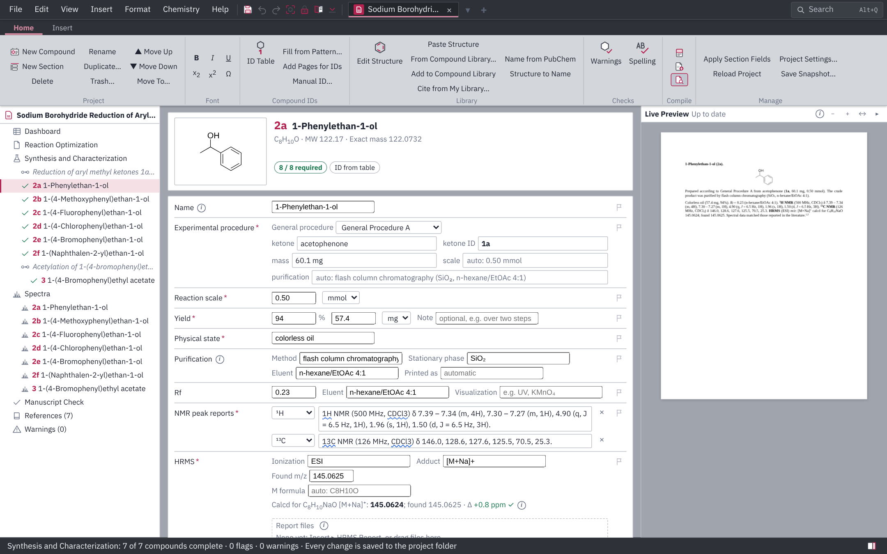

# SI Project (Supporting Information)

An SI Project tab is where you put together the Supporting Information of a paper: each compound with its structure, procedure, yield, NMR data, HRMS and spectra, plus the text sections, tables, schemes and references around them. Chemweave checks the data as you enter it and compiles the whole SI as a document or a PDF.

An SI project is **one file** (`.chemsi`), which you can save, move, email or share in OneDrive like any other file, and double-click to open. Inside it is a zip of the project's folder (`project.json`, `sections/` and so on), so renaming a copy to `.zip` and unzipping it shows every file. SI projects need the desktop app; the web version cannot open them.

## Making or opening a project

- **File ▸ New ▸ SI Project (Supporting Information)…** asks for a title and then where to save the project file.
- **File ▸ Open SI Project…** (or **File ▸ Open…**, or double-clicking the file) opens a project file. A `.zip` of a project folder opens too, as a new project that Save then asks where to put.
- **File ▸ Convert SI Project Folder…** opens an old project kept as a folder: Chemweave saves it as a `.chemsi` file, beside the folder unless you choose elsewhere, and opens that. The folder is left as it was, so you can delete it once you are happy with the file. Documents open at the time that were linked to the folder are linked to the file.

**Save** (Ctrl+S) saves the project file, and **AutoSave** is on for SI projects: it saves a few seconds after you stop making changes (the delay is in **File ▸ Versions and Recovery ▸ AutoSave and Recovery Options**). **File ▸ AutoSave** switches it off for one project. While a project is open, Chemweave works in a copy of it in its own data folder, so editing a large project is as quick as a small one, and nothing is lost if Chemweave or the computer stops: the next time Chemweave starts, it offers to open the changes that weren't saved. **Edit ▸ Undo** and **Redo** work as usual and take back one command at a time, until the tab is closed.

While a project is open, a lock file beside it tells Chemweave on another computer that it is in use. If you open a project that someone else has open, Chemweave says who has it before you go on. If the file is saved somewhere else meanwhile (OneDrive bringing a labmate's changes, say), Save asks before it replaces those changes, and AutoSave stops for the project until you choose.

## The window

- **The list on the left** shows the project (its title, at the top), the **Dashboard**, every section with its compounds and scheme pages under it, and at the bottom **Manuscript Check**, **References** and **Warnings**. A check mark beside a compound means every required field is filled in. Click a row to open its page. Drag rows to reorder them, press **F2** to rename a section, and **Delete** to move a row to the project's Trash. Right-click a row for the same commands, and **Expand All** or **Collapse All**. The arrow beside a section or scheme page folds the rows under it (or double-click the row; the Left and Right keys fold and unfold the picked row). Drag the border between the list and the page to make the list wider or narrower; double-click the border to put it back.
- **The page in the middle** is what you picked: a compound's data, a section's text, a scheme and so on.
- **Live Preview**, on the right, shows the whole SI as it will print, about a second after each change, wherever it is made (**View ▸ Live Preview**, Ctrl+Shift+L). The page picked in the list is brought into view and everything else is washed out, with a bar in the SI color beside it; clicking text in the preview picks its page in the list.
  - **Type in it as in Word.** A change goes into the field the text came from (one step of Undo), and the SI page shows it. Hovering a field on the SI page, or typing in one, lights up its text in the preview, with the field's name; hovering text in the preview lights up its field.
  - **Text Chemweave writes is locked** (the words of a sentence, "calcd for" in HRMS): hovering it shows which field makes it, and clicking it goes to that field. Formatting is changed on the SI page, not in the preview.
  - **Custom text**: text typed where no field is stays as it was typed, after the field before it, every time the SI is compiled (it is kept in *chemweave-custom-text.json* in the project folder). It is marked in the preview and listed on the **Warnings** page; if its page is deleted it goes to the end of the SI.
  - **Synchronous Scrolling** (the button with two pages beside ▸ in the preview's header, off at first and remembered on this computer): scroll the preview and, a moment after you stop, the compound, scheme or section you scrolled to opens in the list and the middle, while the preview stays where you scrolled it. A little scroll never leaves the page you picked, and it never changes page while a field of the SI page (or a box on the ribbon) is selected or being typed in. Page Up and Page Down scroll the preview too.
    It works from the SI page as well: scrolling the page keeps the preview on the field at the same height, and scrolling on past the page's end (or above its start) meets a soft barrier. A bar at the edge names the next (or previous) page and fills as you keep scrolling; push on and that page opens, at its top going down or its end going up. A scroll that only reaches the end, or a fling dying away, never goes through, and one push opens one page: stop scrolling for a moment before the next. Each page stays its own; the pages are never run together. This works while the preview is shown (its header has the button), and a deliberate push changes page even while a field is selected; following the preview's scrolling never does.
  - **Hide white space**: double-click between two pages in the preview (the pointer shows two arrows) to hide each page's top and bottom margins, with its header and footer, so more of the SI fits; double-click the line between pages to show them again. **Preferences ▸ SI Live Preview ▸ Show white space between pages** does the same, and the choice is remembered.
  - **Page Width** (at the right end of the status bar) makes the pages fill the preview's width, with no grey beside them, and keeps them so as the preview is made wider or narrower, until you zoom by hand. The bar between the SI page and the preview sets them apart; drag it to change the preview's width. The arrow on it hides the SI page so the preview takes its width (the list stays, to choose pages); click it again to show the page. This is remembered on this computer, and the page shows again while the preview is folded.
  - **Spectra** show on their own pages when the Spectra section or a compound's spectra page is picked, numbered on from the SI's last page, and can't be typed into.
  - On a page with nothing to preview (the Dashboard, Warnings, References, Manuscript Check) it folds to its strip by itself so the page gets the width, and opens again on the next page it can show. **Preferences ▸ SI Live Preview** sets whether the rest is washed out, and how a field's text and custom text are marked.
- **The ribbon** has **Home**, **Project**, **Insert**, **Layout**, **References**, **Review** and **View** tabs, with Document mode's names for the same commands. Further tabs appear for what you are working on: **Table Layout**, **Picture Format**, **Scheme**, **Spectrum**, **Crystal Structure**, **Attachment**, **Manuscript Check** and **Dashboard**.
  - **Home** holds what is used most: **Paste**, **Cut**, **Copy** and **Format Painter** (copies the look of words in the Live Preview to the words you click or drag over next; double-click it to keep painting until Esc), **New Compound** and **New Section**, **Rename**, **Duplicate** and **Delete**, the **Font** group, **Find**, **Go To** and **Select All**, **Paste Structure** and **Structure to Name**, and **Compile to Document** and **Compile to PDF**. **Paste**, **Cut** and **Copy**, and **Find**, **Go To** (a page of the compiled SI by its number, or a compound by its ID) and **Select All**, act where you were last typing: a box on the SI page or the Live Preview. Find lights up every place in the Live Preview and chooses the page of the one selected.
  - **Project** holds what is used now and then: **Move Up**, **Move Down**, **Move To**, **Trash** and **Apply Section Fields**; the **ID Table** and its commands; the Compound Library and **Name from PubChem**; and **Project Settings**, **Save Snapshot**, **Save Word Snapshot** and **Reload Project**.
  - **Layout** opens the settings the compiled SI is laid out by: **Page Setup** (Project Settings ▸ Page: paper, header, footer and page numbers), **Heading Numbers**, **Caption Labels** and **Structure Layout**.
  - **References**: **Table of Contents** goes to its settings on the project's page; **Insert Citation** cites from My Library in the selected compound's References field; **Manage References** opens the reference list, and its commands (Add by DOI, Delete Reference) are here too; double-click a reference to edit it.
  - **Review**: **Review** (F7) goes to the next misspelled word or chemistry formatting slip on the page; **Dictionary**, **Warnings** and **Manuscript Check**.
  - **View**: **Live Preview**, **Multiple Pages** (two preview pages side by side), **Show/Hide ¶** and **Navigation Pane** (hide the list of sections and compounds for more room) and **Hide SI Page** (the Live Preview fills the width; the arrow on the divider does the same).
  - **Paragraphs in the Live Preview**: click in a paragraph (or select several) and use **Home ▸ Paragraph**: Align Left, Center, Align Right, Justify, Decrease and Increase Indent, and Line Spacing. The look is kept with the paragraph's first words, so it comes back on every compile.
  - **Formatting in the Live Preview**: select words in the preview and use **Home ▸ Font**, including **Small Caps** and **Highlight** (or Ctrl+B, Ctrl+I, Ctrl+U, Ctrl+= and Ctrl+Shift+=). Bold, italics, underline, subscripts and superscripts on a procedure, note or NMR report go into the field, so the SI page shows them too; a font, size or color, and any formatting on words the program writes (a compound's title, "calcd for"), is kept in the project folder (chemweave-preview-format.json) and put back each time the SI is compiled. If the words change, the formatting follows them; if they are deleted, it goes. The font, size and color boxes are greyed while you are typing on the SI page, whose text takes them from the styles.
  - **Layout ▸ Styles** (**Project Settings ▸ Styles**) changes how the compiled SI's Normal text, headings, compound titles, captions and contents heading look. **Use for New SI Projects** keeps them on this computer for projects you make from now on. **Project Settings ▸ Page** also sets the paper size and margins.

## The project's page

Click the title at the top of the list. This page holds everything that prints before the first section:

- **Cover page**: the heading, title, authors with their affiliation letters and corresponding-author emails, the affiliations and an optional extra text. **+ Add Author** and **+ Add Affiliation** under the lists (or **Insert ▸ Author** and **Affiliation**) add rows. **Spacing** sets each gap in points: above the heading (to start it further down the page), and after the heading, the title, the author line, the last affiliation and the email line.
- **Table of contents**: its title and, under **Lists**, a check box for each kind of heading it lists: sections, sub-sections, headings in section text, General Information, general procedures, compounds, spectra, HRMS reports and references. **Links ▸ Link to sections** makes each line of the contents a link to its heading in the PDF and the Word file (on by default).
- **General Information**: materials, instruments and methods.

## Sections

**Home ▸ New Section** asks for a kind and a name:

| Kind | What it holds |
|---|---|
| **Data section** | Compounds, general procedures and scheme pages. Compound IDs come from the section's ID table. |
| **Custom section** | Text, with tables and figures. A Custom section can hold sub-sections. |
| **Attachment section** | A whole PDF or picture printed as a section of its own. |

A project also has a **Spectra** section, where every compound's spectra print, and can have X-ray structure pages (see below).

### Text, tables and figures

In a Custom section, type the text on the page. A line starting with `#` is a heading. Type `@` to mention a compound, table or figure; it prints as its ID or label (**2a**, **Table S1**) and follows any renumbering. Rest the mouse on a compound's ID in the text to see its structure and name. **Home ▸ Font** has bold, italic, underline, subscript, superscript and **Symbol**.

- **Insert ▸ Table** adds a table. Click a cell to type in it and Shift+click to pick a block. The **Table Layout** tab adds and deletes rows and columns, merges cells, sets header rows and alignment, and puts a picture, a drawn structure or a compound's structure in a cell. Ctrl+V in a cell pastes cells from Excel or Word.
- **Insert ▸ Picture**, **Draw Structure**, **Paste Picture** and **Compound…** add a figure. Ctrl+V of a copied drawing or picture in the text also adds one, on the line where the cursor is. Click a figure for the **Picture Format** tab, which changes the picture or sets its printed width. Its **Position** and **Wrap Text** (also on the **Picture Format** tab when you click the figure in the Live Preview, and in its right-click menu there) float the figure with its caption at the left, center or right, with the text beside it (**Square**) or above and below it (**Top and Bottom**, always so in the middle); the next heading, figure or table starts below it. **Project Settings ▸ Layout** sets this for every figure; figures are in the line unless you choose otherwise. (This is for the figures of a text section; a compound's own figures and X-ray structures stay in the line.) In the Word file the figure and caption are in a text frame. A structure drawn here can be opened again with the drawing tools.
- Each table and figure has a caption line in the text (shown in gray italics). Edit it like any other line. Ctrl+click it (⌘-click on a Mac) to go to its table or figure.

Tables, figures and schemes are numbered in the order they print.

## Compounds

Pick a Data section and click **Home ▸ New Compound** (Ctrl+Shift+N). A compound's page has one field for each kind of data. The fields a new compound gets, and which of them are required, are set on the Data section's page under **Fields of new compounds**; **Insert ▸ Field…** adds others such as melting point, IR, optical rotation, enantiomeric excess, diastereomeric ratio, elemental analysis or one of your own.

- **Structure.** Click the structure picture (or double-click the structure in the Live Preview) to open the drawing tools. **Paste Structure** (or Ctrl+V on the structure picture) takes a structure copied from ChemDraw or Chemweave. The formula, molecular weight and exact mass under the ID are worked out from the structure.
- **Where the structure prints.** In the compiled SI a compound's structure sits at the left with the procedure and data beside it, its top level with the first line under the compound's title. Click the structure in the Live Preview for the **Picture Format** tab (or right-click it): **Position** puts it in the line (centered in a paragraph of its own), at the left, center or right, beside or below the title; **Wrap Text** sets how the text goes around it (Square, Top and Bottom, Behind Text, In Front of Text). **Reset to Project Default** takes back the structure's own choice, and **Apply to All Structures** makes it the project's. **Project Settings ▸ Layout** sets it for every structure, with the space between the structure and the text. The next compound always starts below the structure; in the Word file this is a text wrapping break.
- **Name.** Type it, or use **Home ▸ Structure to Name** (worked out on your computer) or **Name from PubChem** (looks the compound up online, and only when you click). Either way the name stays editable.
- **Experimental procedure.** Type the procedure, or choose one of the section's general procedures and fill in the boxes it asks for.
- **Reaction scale, Yield, Physical state, Purification, Rf.** Small boxes with units. Purification and Rf remember the eluents you have typed.
- **NMR peak reports.** Paste the peak report from your NMR software and pick the nucleus. **Insert ▸ NMR Report** adds another one.
- **HRMS.** Choose the ionization and adduct and type the found m/z. Chemweave calculates the expected m/z from the structure and shows the difference in ppm. For a salt measured as its charged piece, the ion prints as [M−Br]⁺ (the counter-ions taken off the whole salt), or as [M]⁺ if you choose that under **Project Settings ▸ Output ▸ HRMS ion for salts**; type in **Printed as** to print any other label. **Insert ▸ HRMS Report…** adds the instrument's report files; the found m/z is read from them when the Found box is empty, and a value you typed is never changed.
- **Spectra.** **Insert ▸ Spectra** adds PDFs or pictures, and **Paste Spectrum** takes one copied in Mnova. Give each its type (¹H NMR, ¹³C NMR, HPLC/SFC, IR and so on).
- **References (known compound).** **References ▸ Insert Citation** cites references from [your reference library](libraries.md).
- **Notes** are private and never print.
- **Store additional files and folders** keeps files with the compound that never print, such as .mnova files, raw data and photos. **Insert ▸ Stored Files…** adds them, or drag files onto the field (or click it and press Ctrl+V to paste files copied in File Explorer or Finder). Copies go in the compound's `private` folder. Give each a note if you like; ✕ moves it to the project's Trash.

The flag button beside a field marks it for checking, with a comment. Flags are counted on the status bar and the Dashboard.

**Home ▸ Duplicate…** copies a compound with the fields you choose, which is a quick way to start a series of analogs. **From Compound Library…** starts a page from a compound in [your compound library](libraries.md), and **Add to Compound Library** saves a section's structures there with their SI IDs.

### Compound IDs

Each Data section has an **ID table**: row 1 is the first compound's ID, row 2 the second's, and so on. Moving a compound up or down therefore renumbers it, and every `@` mention follows.

- **Project ▸ Fill from Pattern…** fills the table with a series such as 3a, 3b, 3c or S1, S2, S3.
- **Add Pages for IDs** makes a blank compound page for each ID that has none.
- **Manual ID…** gives one compound an ID of its own. It still uses up its row of the table.

### General procedures

**Insert ▸ General Procedure** adds one to a Data section. Its text prints once at the start of the section. Each compound that uses it gets the procedure's *compound sentence*, in which words in braces are filled in for that compound: `{GP}`, `{scale}`, `{yield}`, `{product}` and `{purification}` fill themselves in from the compound's fields, and any other placeholder, such as `{ketone}`, becomes a box to type in on the compound's page.

### Scheme pages

**Insert ▸ Scheme Page** adds a reaction scheme to a Data section: starting materials, steps with their conditions, and products. Double-click a box to draw its structure, and click above or below an arrow to type the conditions. The **Scheme** tab adds and removes boxes and steps and moves them.

**Scheme ▸ Mark as Compound** gives a box a compound page with an ID and data, so a scheme's products are the section's compounds. **Insert ▸ Change to Reaction Scheme…** turns an existing compound into the product of a new scheme. **Scheme ▸ Layout…** sets the text size, arrows, the size of structures in the conditions, and whether IDs and yields are shown, for one scheme or for every scheme of the project.

## Spectra pages

The **Spectra** section's page sets how every spectrum prints: one, two or four to a page, portrait or landscape, with a header line, and with the compound's structure and ID. **Place** puts the structure box on the spectrum in a corner, on blank space over the spectrum (above it when it fits nowhere, made smaller first if **Shrink to fit** is ticked), or above or beside the spectrum, which is made smaller to leave it room.

**Links** sets which links the PDF and Word file get: **Peak reports to spectra** (“¹H NMR” at the start of a peak report goes to the compound's spectrum) and **Spectra back to compounds** (each spectrum's header line goes back to the compound's data). **Look** prints them like normal text, in a color, or in a color and underlined.

Under the Spectra section, each compound has a spectra page of its own. Pick a spectrum to see it as it prints. Drag the structure box anywhere on the spectrum and resize it by its corners (a box above or beside the spectrum is resized only; choose another **Place** to drag it). A setting changed here applies to this spectrum only and is shown in bold; click the × beside it to follow the section again. The **Spectrum** tab changes the print order and says whether a setting is for one page or for every page of a PDF.

## X-ray structures and attachments

To add one, use **Home ▸ New Section** and choose **X-ray structure**, then **Choose CIF**. With a compound picked, the new structure shows that compound, so its ID is in the captions. An X-ray structure page shows the structure from its CIF file as it prints, with a caption and a table of crystal data. **Crystal Structure ▸ Edit Structure** (or a double-click) turns it and changes its style and labels; **Choose CIF** uses another file. Type over a value in the crystal data table to change it, or untick a row to leave it out.

On an Attachment section's page, **Attachment ▸ Choose File** picks the PDF or picture, or drop a file on the preview.

## References

Click **References** in the list. The **References** tab adds a reference by DOI (filled in from Crossref, which needs the internet), by hand, from a BibTeX or RIS file, or from My Library. Only the references you cite are printed, numbered in the order they are first cited and formatted in the project's journal style. The list shows where each one is cited.

## Checking your data

- **Warnings.** Chemweave checks every compound as you work: for example, a found HRMS mass further from the calculated one than the project's tolerance, an NMR report with no matching spectrum attached, or a fluorine in the structure with no ¹⁹F data. Click **Warnings** in the list (or **Home ▸ Warnings**) to see them all by compound. Warnings never stop you from doing anything. Dismiss one that doesn't apply, with a reason; it comes back if the data it is about changes.
- **Dashboard.** Shows how complete the project is: a table of every compound with one column per field, marked filled, empty, required but empty, flagged or with a warning. Click a cell to open the compound at that field. Drag a header's right border to change its column's width (double-click it to put it back), drag a field's header to move its column, and right-click a header to show or hide columns. The **Dashboard** tab also picks the columns (**Columns…**) and filters the rows.
- **Spelling** (**Home ▸ Spelling**, F7). Chemistry words, abbreviations such as MeOH and CDCl3, and systematic names count as spelled correctly.
- **Manuscript Check.** Add the manuscript (PDF, Word, or a document open in Chemweave) and, best of all, its ChemDraw files saved as `.cdxml`. Chemweave compares them with the SI compound by compound: IDs, structures, yields, ee and dr, and names. Double-click a result to open the compound at the field concerned. The files are kept in the project's folder and never print; nothing is sent anywhere.

## Compiling the SI

- **Home ▸ Compile to Document** makes the Supporting Information as a Chemweave document you can edit: cover, contents, sections, procedures and compound data. The project itself is not changed.
- **Home ▸ Compile to PDF** compiles it and saves a PDF.
- While it compiles, a window shows how far along it is (compounds, spectra, then the pages and the PDF), with **Cancel**.
- **Home ▸ Manage ▸ Save Word Snapshot** saves the whole compiled SI as *(project title) (Snapshot).docx* beside the project file, as a backup: if Chemweave or the project can't be opened, you can go on in Word. It is also saved every 5 minutes while the project changes, and when the project closes. It is never a step of Undo, and a copy you changed in Word is never replaced: rename it, and the next snapshot is saved beside it. Each flag on the SI page is a Word comment in it, on the text of its field (who flagged it and what to check); a flag on a field that prints nothing is on the compound's name.
- **Compile to Document** and **Compile to PDF** ask, when the SI page has flags, whether to put them in as comments too (**Include Comments**) or leave them out.

**Project ▸ Project Settings…** holds the choices for the compiled SI:

| Page | What it sets |
|---|---|
| **Output** | Journal style (ACS, Wiley or RSC), the HRMS tolerance in ppm, and which NMR reports are added for you |
| **Headings** | How headings are numbered |
| **Page** | Header, footer and page numbers |
| **Labels** | The words and numbering for figures, tables and schemes |
| **Layout** | Where compound structures and figures go and how the text wraps around them |
| **Structures** | The drawing style of structures |
| **Schemes** | The layout of every scheme |
| **NMR Impurities** | The solvent and impurity peaks the NMR check knows |
| **Dictionary** | Words the spelling check leaves alone |

## Importing an existing SI

**Insert ▸ Import SI…** reads a Supporting Information you already have, as a Word file or a PDF, and finds its general procedures, compounds, sections, figures, tables and references. A review window shows what was read; correct anything read wrongly and untick what you don't want. Nothing is written until you click **Import**, and the whole import is one step of Undo.

## Linking a manuscript to its SI

A manuscript written in [Document mode](documents.md) can be linked to its SI project, so the two stay in step. The commands are on the document's **References** tab:

- **Linked SI** links the document to an SI project.
- **SI Compound…** puts a compound's number in the text.
- **SI Reference…** puts in the label of a table, figure or scheme in the SI (Table S1), or the SI page something is on (S6). These follow the SI when it changes.
- **Check Against SI** lists compounds missing from the SI and yields, ee and dr that differ between the two.

The manuscript's compound numbers lead. **Renumber SI**, in the Linked SI panel of the side panel, gives the SI's compounds the manuscript's IDs. Ctrl+click a linked number to open that compound in the SI.

In a Canvas, right-click a structure and choose **Add to SI Project** to add it to a Data section of an open project. When a structure you select is already a compound of an open SI project, the side panel shows its ID, how complete its data is and its warnings.

## Trash and snapshots

- **Project ▸ Trash…** lists what was deleted from the project, newest first, and puts items back. The Trash is kept inside the project.
- **Project ▸ Save Snapshot…** zips the whole project into a *(file name) Snapshots* folder beside the project file. Use it at milestones such as the submitted version. The Word snapshot is left out of the zip (it is made again from the project).

Next: [Getting started](getting-started.md) · [Canvas](drawing.md) · [Document](documents.md) · [Libraries](libraries.md) · [Files and sharing](files-and-sharing.md) · [Feedback](feedback.md)
